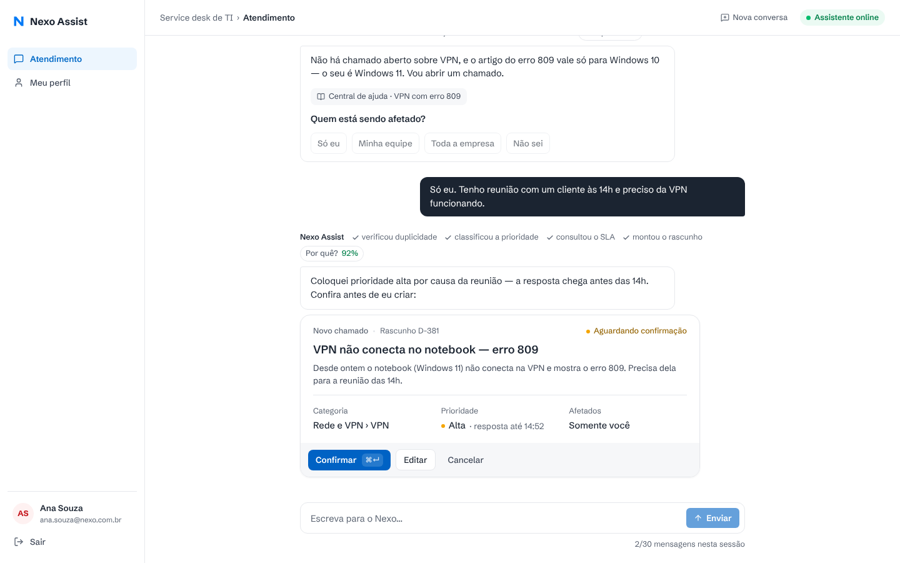
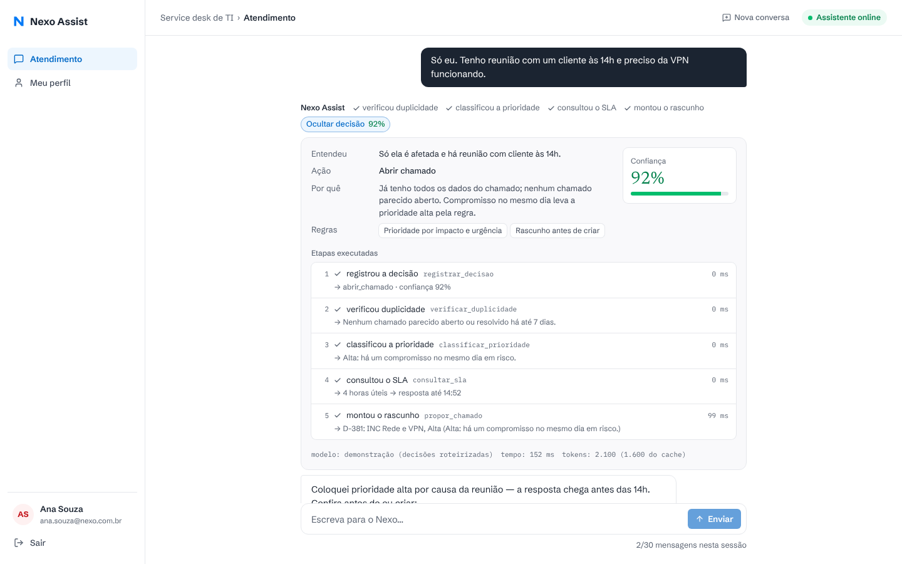
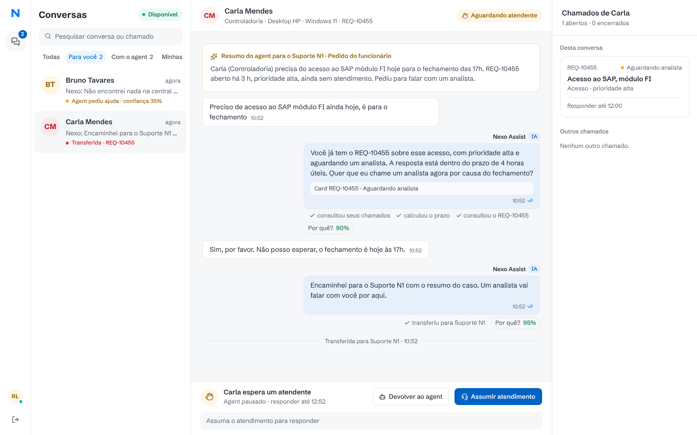

# Nexo Assist

O agent de atendimento do service desk de TI da Nexo. O funcionário descreve o problema num chat e o agent decide o que fazer: responder uma dúvida com a central de ajuda, consultar ou complementar um chamado, abrir um chamado novo (com rascunho para confirmar) ou chamar um analista. Do outro lado, o analista usa um console para assumir conversas, responder e devolvê-las ao agent.



| Detalhe da decisão (o que entendeu, ação, confiança, por quê, etapas) | Console do analista |
| --- | --- |
|  |  |

> As capturas usam as conversas de exemplo de `npm run seed:demo`: passam pelo pipeline real (ferramentas, serviço de chamados, regras, salvaguardas), mas as escolhas do modelo são roteirizadas — por isso o rodapé mostra "modelo: demonstração".

---

## Como rodar

Requisitos: **Node.js 22.13+** e uma chave da API da Anthropic. Localmente o banco é um Postgres embutido (PGlite) — nada para instalar.

```bash
npm install
npm run setup          # cria o .env a partir do .env.example
# edite o .env: ANTHROPIC_API_KEY, SESSION_SECRET e TICKETS_SERVICE_KEY
npm run dev            # sobe o serviço de chamados (:4001) e o app (:3000)
```

Abra http://localhost:3000. Qualquer senha funciona para os usuários de exemplo (a tela de login lista os principais):

| Usuário | Perfil | Bom para testar |
| --- | --- | --- |
| `ana.souza@nexo.com.br` | funcionária, Windows 11 | 3 chamados abertos (INC-20311 **vencido**), 1 resolvido há 4 dias (reabrível), VPN com erro 809 |
| `bruno.tavares@nexo.com.br` | funcionário, Windows 10 | impressora da equipe, licença de software |
| `elisa.prado@nexo.com.br` | funcionária | sem chamados — abrir o primeiro |
| `rafael.lima@nexo.com.br` | analista N2 | console do analista |
| `juliana.costa@nexo.com.br` | analista N1 | console (segundo analista, para testar posse da conversa) |

Opcional: com só o serviço de chamados no ar (`npm run dev:tickets`), `npm run seed:demo` cria três conversas de exemplo (Carla transferida, Bruno com "agent pediu ajuda", Diego resolvido pelo agent) para o console não começar vazio. As conversas de Ana e Elisa ficam livres.

Outros comandos: `npm test` (43 testes), `npm run typecheck`, `npm run lint`, `npm run build && npm start` (produção), `npm run reset-data` (apaga os bancos; o seed roda de novo no próximo início).

Roteiros sugeridos (logado como Ana):
1. "Meu notebook não conecta na VPN, erro 809" → busca o artigo, percebe que ele vale só para Windows 10, pergunta quem é afetado, monta o rascunho, você confirma.
2. "Qual o status do meu chamado?" → seletor com os 3 abertos → escolha o INC-20311 → card com **prazo vencido** e oferta de chamar um analista.
3. "Meu notebook continua lento depois da atualização" → detecta o INC-20311 e propõe **complementar** em vez de abrir outro.
4. "A senha do SAP bloqueou de novo" → propõe **reabrir** o INC-20150 (resolvido há menos de 7 dias).
5. "Qual o saldo do meu vale-refeição?" → fora do escopo de TI, redireciona.
6. "Quero falar com um analista" → transfere; entre como Rafael em outra janela, assuma, responda e devolva ao agent.

---

## Arquitetura

```
 Navegador ──────────────► Next.js (App Router)
  chat · console           ├─ src/app            páginas e rotas de API (sessão, chat em SSE, rascunhos, console)
                           ├─ src/server/agent   agent Mastra: prompt, ferramentas, executor do turno, rastro
                           ├─ src/server         sessão, banco do app, rascunhos, console, cliente do serviço
                           └─ src/domain         regras do service desk (prioridade, prazos, duplicidade) — puras e testadas
                                    │
                                    │ HTTP + chave de serviço + "em nome de quem" (retentativa, timeout, idempotência)
                                    ▼
                           services/tickets      serviço de chamados simulado (Hono), banco próprio,
                                                 privacidade por solicitante, falhas aleatórias do "legado"
```

- **Interface** (`src/app`, `src/components`) não conhece o agent: fala só com as rotas de API. O chat recebe a resposta por **SSE** (etapas, texto e cards em tempo real).
- **Agent** (`src/server/agent`) é um `Agent` do **Mastra** com 9 ferramentas. Cada turno é executado por `runTurn`, que monta o histórico, roda o modelo, transmite os eventos, aplica as salvaguardas e grava a resposta com o rastro completo.
- **Serviço de chamados** (`services/tickets`) é um processo separado, com banco e API próprios. O app só o acessa por HTTP, como faria com o sistema legado real. Ele simula instabilidade (`TICKETS_FAILURE_RATE`, padrão 10% de 503).
- **Domínio** (`src/domain`) concentra as regras do Anexo A em funções puras, usadas pelo agent, pelo serviço e pela interface.
- **Persistência**: Postgres — Neon em produção, PGlite (Postgres embutido) local. Dois bancos: o do app (usuários, conversas, mensagens com o rastro, rascunhos, estado agent/analista) e o do serviço de chamados (chamados, central de ajuda, chaves de idempotência). Tudo sobrevive a reinício.

## Como o agent decide

A cada mensagem o modelo escolhe **uma ação principal** (responder dúvida, consultar, complementar, abrir, pedir informação, transferir, redirecionar) e usa ferramentas para executá-la:

| Ferramenta | O que faz |
| --- | --- |
| `buscar_central_ajuda` | busca artigos (o modelo decide se o artigo se aplica, ex.: Windows 10 × 11) |
| `listar_meus_chamados` / `consultar_chamado` | chamados do funcionário, com status e prazo calculado |
| `pedir_selecao_chamado` / `perguntar` | seletor de chamados e perguntas com opções rápidas |
| `propor_chamado` | monta o **rascunho**: verifica duplicidade, aplica a regra de prioridade, calcula o prazo |
| `propor_atualizacao` | rascunho de complemento ou reabertura (≤ 7 dias) |
| `transferir_para_analista` | pausa o agent, leva um resumo para o analista e marca o chamado |
| `registrar_decisao` | declara entendimento, ação, confiança (0–1), justificativa e regras aplicadas |

O ponto central do desenho é **dividir o trabalho entre o modelo e o código**: o modelo faz o que exige linguagem e julgamento; o código garante as regras que não podem falhar.

| Decide o modelo | Garante o código |
| --- | --- |
| entender o pedido e escolher a ação | **prioridade** a partir de impacto e urgência (`classifyPriority`) — o modelo só informa os fatos |
| quando perguntar e o quê | **prazos** em horário útil, vencimento e pausa (`sla.ts`) |
| se um artigo resolve o caso | **duplicidade**: `propor_chamado` recusa montar rascunho se houver chamado parecido aberto ou reabrível |
| título, descrição e resumo para o analista | **confirmação**: o agent não tem ferramenta que grave no sistema; só o clique em Confirmar grava |
| quando transferir | **transferência por baixa confiança**: abaixo de `NEXO_MIN_CONFIDENCE` (0,4) o servidor transfere mesmo que o modelo não o faça |
| | **privacidade**: o e-mail vem do cookie assinado; o serviço de chamados responde 404 a chamados de outra pessoa |
| | **agent pausado** com analista: a rota nem chama o modelo |

## Transparência

Acima de cada resposta aparece a linha de ações do protótipo ("consultou seus chamados · classificou a prioridade · consultou o SLA · montou o rascunho"). O botão **Por quê?** (com a confiança, ex.: 92%) abre o detalhe:

- **Entendeu / Ação / Por quê / Regras** — declarados pelo modelo em `registrar_decisao`;
- **Confiança** com barra colorida (verde ≥ 75%, amarelo, vermelho < 40%);
- **Etapas executadas** em ordem, com duração, tentativas no sistema legado, resumo do resultado e a entrada de cada ferramenta;
- **Salvaguardas do servidor** quando alguma foi aplicada (modelo não declarou a decisão, transferência por baixa confiança, falha do modelo);
- **Modelo, tempo, tokens (quantos vieram do cache) e custo estimado** do turno.

O mesmo rastro fica gravado com a mensagem e aparece para o analista no console, junto com o **resumo da transferência** e a etiqueta "Agent pediu ajuda · confiança 35%". Ações executadas pelo servidor (confirmar rascunho) também têm rastro, com "modelo: nenhum".

## Como garanti a qualidade das decisões

- **Regras como código testado** (`tests/rules.test.ts`): matriz de prioridade, prazos atravessando noite e fim de semana, plantão 24 h para crítica, pausa do prazo, duplicidade com outras palavras, janela de reabertura.
- **Turnos completos com modelo roteirizado** (`tests/agent-turn.test.ts`): um modelo falso do AI SDK devolve chamadas de ferramenta pré-definidas e o resto é real — Mastra, ferramentas, serviço de chamados HTTP, salvaguardas e banco. Cobre: pergunta antes de abrir; rascunho com prioridade da regra e nada criado antes da confirmação; duplicidade; chamado de outra pessoa; transferência pedida e por baixa confiança; legado fora do ar com 4 tentativas; modelo que esquece de declarar a decisão.
- **Serviço e fluxos** (`tests/ticket-service.test.ts`, `tests/conversation-flow.test.ts`): autenticação do serviço, privacidade, idempotência, confirmação única, rascunho preservado quando o legado cai, posse da conversa no console, sessão adulterada ou expirada, histórico enviado ao modelo.
- **Prompt com regras explícitas** e ferramentas com descrições e schemas restritos (zod), para o modelo errar menos e, quando errar, a validação recusar.

O que esses testes **não** medem é a qualidade das escolhas do modelo real em conversas abertas. O próximo passo seria um conjunto de avaliação (abaixo).

## Modelo e custo

- **Claude Opus 5.5** (`claude-opus-5-5`, Anthropic), com **esforço baixo** (`NEXO_EFFORT=low`). O critério mais importante do desafio é a qualidade das decisões, e o Opus é o modelo mais forte em seguir regras e usar ferramentas; com esforço baixo ele raciocina pouco em conversas simples, o que mantém latência e custo sob controle. Troque por `claude-sonnet-5-5` ou `claude-haiku-5-5` em `NEXO_MODEL` para reduzir custo — o painel de decisão mostra o custo por turno para comparar.
- **Cache de prompt**: instruções e ferramentas são idênticas em todas as chamadas (nada de data ou nome no prompt fixo); o contexto variável (funcionário, hora, rascunhos pendentes) vai no fim da última mensagem. Assim, cada etapa do turno e os turnos seguintes leem o prefixo do cache.
- **Uso consciente**: histórico limitado às últimas 16 mensagens, cards resumidos em uma linha para o modelo, no máximo 6 etapas e 1.500 tokens de saída por turno; confirmar/cancelar rascunho não chama o modelo; conversa com analista não chama o modelo.
- **Limites**: 30 mensagens por sessão (como no protótipo), 120 turnos do agent por usuário por dia, 20 mensagens por minuto por IP e 20 tentativas de login por minuto por IP.
- **Resiliência**: fallback de modelo do lado do servidor (`fallbacks: "default"` da Anthropic) e, se o modelo falhar, uma resposta clara ao funcionário em vez de erro.

## Segurança e privacidade

- Chaves só no `.env` (nunca no código ou no cliente); `.env` fora do git.
- Sessão em cookie `httpOnly`, `sameSite=lax`, assinado com HMAC; o servidor nunca confia em e-mail vindo do corpo da requisição ou do modelo.
- As ferramentas recebem o funcionário pela closure do turno; o serviço de chamados aplica de novo a regra (funcionário só vê os próprios chamados; resposta 404, sem confirmar que o chamado existe).
- Serviço de chamados exige chave compartilhada, comparada em tempo constante.
- Rascunho só é confirmado pelo dono; conversa só é respondida pelo analista que a assumiu.

## Principais trade-offs

- **Postgres com dois motores** (Neon em produção, PGlite local): o mesmo SQL nos dois ambientes e nenhuma instalação local; o custo é o PGlite aceitar um processo por vez e levar ~2 s para iniciar nos testes.
- **Histórico gerenciado pelo app**, não pela memória do Mastra: o app já precisa guardar mensagens, cards e rastro para a interface e o console; mandar ao modelo uma versão resumida dá controle sobre custo.
- **Confiança declarada pelo modelo** é uma autoavaliação, não uma probabilidade calibrada. Por isso há também salvaguardas determinísticas e o limite é configurável.
- **Atualização por polling (3 s)** no console e no chat com analista, em vez de WebSocket: simples e robusto para o volume esperado.
- **Busca da central por termos**, não semântica: com 9 artigos é suficiente e previsível.
- **Fuso fixo de Brasília (UTC−3)** nos prazos; não há feriados.

## O que eu faria com mais tempo

1. **Conjunto de avaliação** com 50–100 conversas reais anonimizadas e o resultado esperado (ação, categoria, prioridade, transferir ou não), rodando contra o modelo real a cada mudança de prompt, com custo por conversa.
2. Calibrar o limite de confiança com esses dados e medir taxa de transferência e de duplicidade evitada.
3. Notificações em tempo real (SSE/WebSocket) no console, fila com SLA de primeira resposta da transferência e atribuição automática por nível.
4. Busca semântica na central de ajuda e feedback "isso resolveu?" para medir a resolução sem fila.
5. Feriados e fuso por funcionário nos prazos; limites de taxa em armazenamento compartilhado (hoje ficam na memória de cada instância serverless).
6. Mascarar dados sensíveis (senhas digitadas por engano) antes de enviar ao modelo.

## Deploy (gratuito)

Tudo roda em planos gratuitos:

| Peça | Onde | Plano |
| --- | --- | --- |
| App (Next.js: telas, API, agent) | Vercel, projeto `nexo-assist` | Hobby (grátis) |
| Serviço de chamados (Hono) | Vercel, projeto `nexo-assist-tickets`, raiz `services/tickets` | Hobby (grátis) |
| Bancos (`nexo_app` e `nexo_tickets`, separados) | Neon Postgres | Free |

Por que assim: Vercel e Render gratuitos não têm disco persistente, então o SQLite de arquivo seria perdido a cada reinício. Por isso a persistência é Postgres (`src/db/sql.ts`): Neon em produção (driver HTTP, adequado a serverless) e PGlite — o mesmo Postgres, embutido — no desenvolvimento local e nos testes, sem instalar nada. O serviço de chamados continua sendo um deploy separado, com banco próprio, acessado só por HTTP com chave de serviço.

Variáveis na Vercel:
- **App**: `ANTHROPIC_API_KEY`, `SESSION_SECRET`, `DATABASE_URL` (Neon `nexo_app`), `TICKETS_URL` (URL do projeto de chamados), `TICKETS_SERVICE_KEY`, `NEXO_DAILY_TURN_LIMIT=60`.
- **Chamados**: `TICKETS_DATABASE_URL` (Neon `nexo_tickets`), `TICKETS_SERVICE_KEY` (a mesma do app), `TICKETS_FAILURE_RATE=0.1`.

Custos e abuso: o único item pago é o uso da API da Anthropic. Ele é limitado por 60 turnos do agent por usuário por dia (só existem os usuários de exemplo, então isso também limita o total diário), 20 mensagens por minuto por IP e 30 mensagens por conversa. As chaves ficam só nas variáveis de ambiente da Vercel.

Conversas de exemplo em produção: `DATABASE_URL=... TICKETS_URL=https://<chamados>.vercel.app TICKETS_SERVICE_KEY=... npm run seed:demo`. Localmente, rode o seed com o app parado (o PGlite aceita um processo por vez) e o serviço de chamados no ar (`npm run dev:tickets`).

O `Dockerfile` continua disponível para quem preferir um único container com disco próprio.

## Uso de IA

O projeto foi desenvolvido com o Claude Code como par de programação: leitura do PRD e do protótipo, desenho da arquitetura, implementação, testes e revisão. As decisões de desenho (divisão modelo × código, confirmação fora do modelo, rastro por turno) estão justificadas acima.
